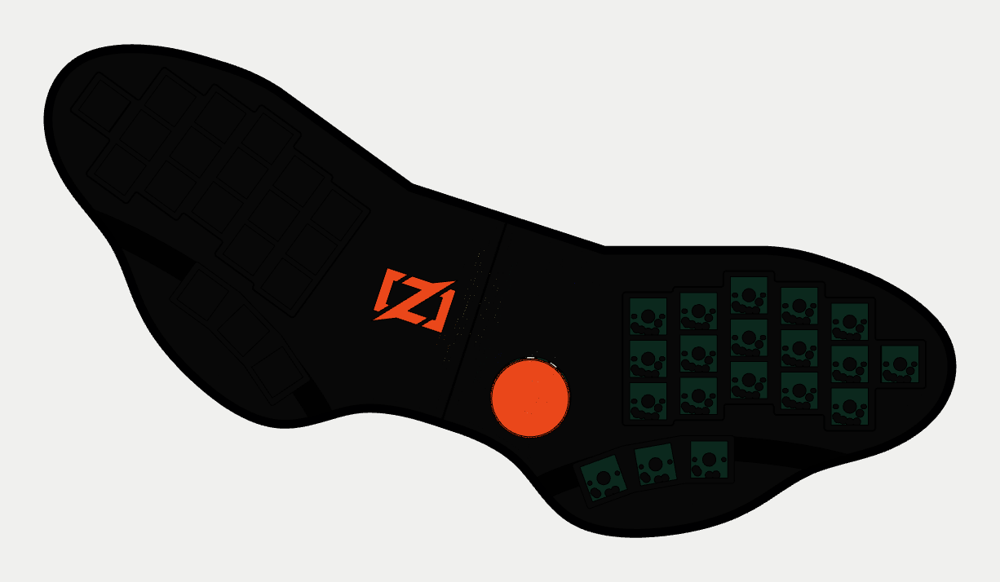
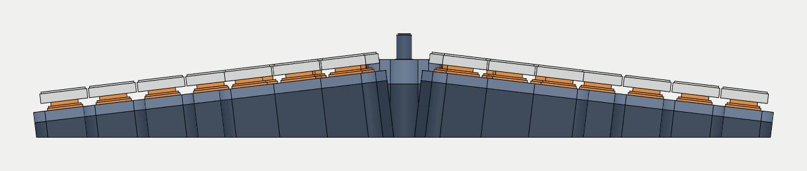

# Molekula · 38 keys

Molekula is a split ergonomic keyboard with 19 keys per side, a minY grid of 19 × 16 mm and an RP2040 Helios 16M. This fork of Molekula2 adds one position to the top finger row on each side and keeps both outer keys. An encoder and a header for a nice!view are provided on the central board.

| Folder | Contents |
| --- | --- |
| [pcb/](pcb/) | KiCad project, schematic, board and library tables for the 38-key fork |
| [production/](production/) | Gerber and drill data as a manufacturing package, plus BOM and placement data for SMD assembly |
| [case/](case/) | Both case variants: the split case with magnetic connectors and the FluidCAD model of the unibody case |
| [keycaps/](keycaps/) | Sculpted Choc keycaps and a separate thumb model |
| [images/](images/) | Renders of the case variants |

## Case variants

### Split case with magnetic connectors



The two halves are joined by magnetic connector boards and can be separated. The Onshape model is available as [STEP](case/onshape/molekula.step). The [Artisan](case/keyboard_artisan.3mf) and [P1S](case/keyboard_p1s.3mf) print projects contain the case tops with 19 switch openings per side.

### Unibody case with printed tenting (work in progress)




This variant has no magnetic connectors. It is one continuous case made of a top and a bottom shell that hide the FFC cables. The MCU board sits upside down in the middle, so the Helios and the encoder face up and the reset button is reachable from below. The nice!view is not used.

The halves are tented from the outside in, like a roof: the outer edges stand on the desk, and the inner edges and the middle are raised by the wedge thickness. There is no front-to-back tilt. The wedge is printed into the bottom shell.

The model lives in [case/fluidcad/](case/fluidcad/) and is built with [FluidCAD](https://fluidcad.io) 0.0.51. Open [`keyboard.assembly.js`](case/fluidcad/keyboard.assembly.js) in the FluidCAD editor. The parameter **Center wedge thickness (mm)** sets the tenting; 15 mm corresponds to about 6.8°. The configurations Flat and Wedge 10/15/20/25 mm are starting points, and the parameter panel lets you save your own. The components are simplified envelope bodies so the editor stays responsive. **Detailed models (slow)** switches to the imported originals for a final check.

Each shell prints in one piece. Diagonally the keyboard needs a square of about 214 mm, so it fits a 256 × 256 mm bed. In the model each shell consists of three overlapping bodies. To get one solid per shell as STEP and STL in `case/fluidcad/print/`, run:

```sh
node case/fluidcad/tools/print-files.mjs 15   # center wedge thickness in mm
```

Still open: the tilted rims of the top shell need supports or a different print orientation, and the encoder knob is not modelled yet.

## Board and manufacturing

Open [`pcb/pcb.kicad_pro`](pcb/pcb.kicad_pro) in KiCad 9. For library access and the referenced 3D models, `ZZKEEB` must point to a local library with `zzkeeb.pretty`, `zzkeeb.kicad_sym` and `models/`. The library lives outside this repository.

The [manufacturing package](production/pcb.zip) contains the panel data for both key boards, the central board and two magnetic connector boards. The five boards are separated for assembly; the unibody case does not use the connector boards. [BOM](production/bom.csv) and [positions](production/positions.csv) are also available as CSV. The BOM covers SMD assembly with diodes and FFC sockets. Switches, hotswap sockets, MCU and case parts must be sourced separately. When the KiCad project changes, update the manufacturing data together with it.

## Firmware

A firmware build for the Helios and the 38-key matrix is not included in this repository. Before flashing, check controller, pinout and both additional positions against the [schematic](pcb/pcb.kicad_sch). The [mechanical reference](DESIGN.md) describes the reference points the FluidCAD model is derived from.

## Origin

This project is based on [Molekula by Evgenii Vilkov (zzeneg)](https://github.com/zzeneg/molekula). It is licensed under the [MIT license](LICENSE). Earlier case, image and comparison files can be found in the Git history at the starting point `78ca099`.
