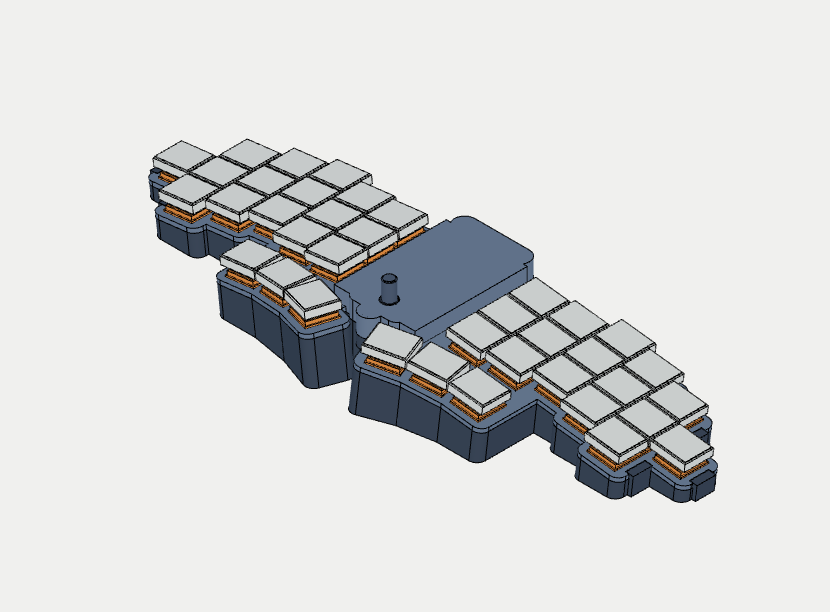
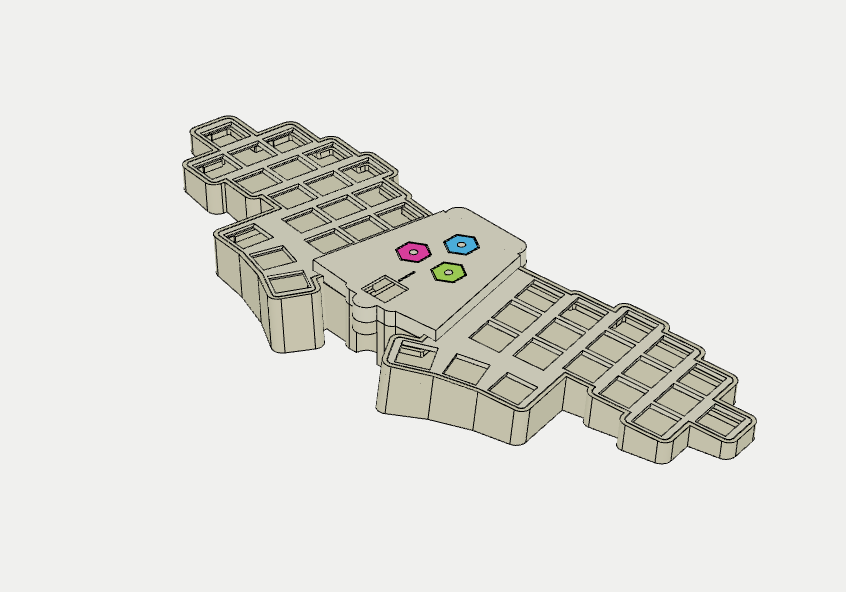

# Molekula · 38 keys

Molekula is a split ergonomic keyboard with 19 keys per side, a minY grid of 19 × 16 mm and an RP2040 Helios 16M. This fork of Molekula2 adds one position to the top finger row on each side and keeps both outer keys. An encoder and a header for a nice!view are provided on the central board.

| Folder | Contents |
| --- | --- |
| [pcb/](pcb/) | KiCad project, schematic, board and library tables for the 38-key fork |
| [production/](production/) | Gerber and drill data as a manufacturing package, plus BOM and placement data for SMD assembly |
| [case/](case/) | Both case variants: the split case with magnetic connectors and the FluidCAD model of the unibody case |
| [keycaps/](keycaps/) | Sculpted Choc keycaps and a separate thumb model |
| [images/](images/) | Renders of the case variants |

## Case variants

### Split case with magnetic connectors


The two halves are joined by magnetic connector boards and can be separated. The Onshape model is available as [STEP](case/onshape/molekula.step). The [Artisan](case/keyboard_artisan.3mf) and [P1S](case/keyboard_p1s.3mf) print projects contain the case tops with 19 switch openings per side.

### Unibody case with printed tenting (work in progress)




This variant has no magnetic connectors. It is one continuous case made of a bottom shell and a top shell that hide the FFC cables. The MCU board sits upside down in the middle, so the Helios and the encoder face up and the reset button is reachable from below. The nice!view is not used.



The top shell consists of three print parts:

- **Top plates (left and right):** 2.2 mm thick and flat, lying on the key boards. They hide the green boards. The switches are pushed through 14 mm cut-outs into the hotswap sockets, and their clips catch under the plate as on a normal Choc plate. The outer wall of the bottom shell rises to the top of the plates, so the plates sit recessed in a pocket and the side shows one flat wall. The key boards have no mounting holes. Instead, seven crush ribs per side on the inside of the wall hold each plate: they stand 0.35 mm out of the wall and are squeezed by 0.15 mm when the plate is pressed in.
- **Middle cover:** covers the Helios, the FFC sockets and the cables. Its flat top reaches over the cable gap onto the inner edges of both plates and clamps them. It is 7 mm high above the board, just as high as the square body of the encoder, which sits flush in a square opening. The cut-out for the USB-C plug is centred on the real receptacle and continues as a small notch in the bottom shell. The heights come from the built keyboard: the Helios is soldered almost flat onto the board with its parts facing up, the top of the USB-C receptacle is 4.5 mm above the board, the encoder body 7 mm, the shaft tip 15.6 mm. In the model, Helios and encoder are built from these measurements instead of the KiCad 3D models.

Only three M2 screws hold the case together. They go from below through the bottom shell and the holes H5–H7 of the MCU board into M2 heat-set inserts (Ø 3.2 mm hole, 4.5 mm deep) in the middle cover. The access holes from the desk side are 11 mm wide, enough for a screwdriver shaft of 10 mm. M2 × 8 screws reach 4.3 mm into the inserts. Nothing is glued.

Assembly: put the boards into the bottom shell and connect the cables. Press each plate into its pocket. Put the middle cover on and screw it from below. Then push in the switches.

The halves are tented from the outside in, like a roof: the outer edges stand on the desk, and the inner edges and the middle are raised by the wedge thickness. There is no front-to-back tilt. The wedge is printed into the bottom shell.

The model lives in [case/fluidcad/](case/fluidcad/) and is built with [FluidCAD](https://fluidcad.io) 0.0.51. Open [`keyboard.assembly.js`](case/fluidcad/keyboard.assembly.js) in the FluidCAD editor. The parameter **Center wedge thickness (mm)** sets the tenting; 15 mm corresponds to about 6.8°. The configurations Flat and Wedge 10/15/20/25 mm are starting points, and the parameter panel lets you save your own. The components are simplified envelope bodies so the editor stays responsive. **Detailed models (slow)** switches to the imported originals for a final check.

The bottom shell prints in one piece. Diagonally it needs a square of about 214 mm, so it fits a 256 × 256 mm bed. The three top parts each have one flat top face and print upside down on it, without supports; together they fit on one bed. In the model the bottom shell consists of three overlapping bodies. To get the bottom shell as one solid and the top parts already turned onto their top faces, as STEP and STL in `case/fluidcad/print/`, run:

```sh
node case/fluidcad/tools/print-files.mjs 15   # center wedge thickness in mm
```

Still open:

- The crush ribs have not been test-printed yet. If the plates sit too tight or too loose, change the parameter **Gap between top plate and wall (mm)**.
- The encoder knob is not modelled yet.
- The battery sockets J7 and J12 on the top side of the key boards would collide with the plates if populated.

## Board and manufacturing

Open [`pcb/pcb.kicad_pro`](pcb/pcb.kicad_pro) in KiCad 9. For library access and the referenced 3D models, `ZZKEEB` must point to a local library with `zzkeeb.pretty`, `zzkeeb.kicad_sym` and `models/`. The library lives outside this repository.

The [manufacturing package](production/pcb.zip) contains the panel data for both key boards, the central board and two magnetic connector boards. The five boards are separated for assembly; the unibody case does not use the connector boards. [BOM](production/bom.csv) and [positions](production/positions.csv) are also available as CSV. The BOM covers SMD assembly with diodes and FFC sockets. Switches, hotswap sockets, MCU and case parts must be sourced separately. When the KiCad project changes, update the manufacturing data together with it.

## Firmware

A firmware build for the Helios and the 38-key matrix is not included in this repository. Before flashing, check controller, pinout and both additional positions against the [schematic](pcb/pcb.kicad_sch). The [mechanical reference](DESIGN.md) describes the reference points the FluidCAD model is derived from.

## Origin

This project is based on [Molekula by Evgenii Vilkov (zzeneg)](https://github.com/zzeneg/molekula). It is licensed under the [MIT license](LICENSE). Earlier case, image and comparison files can be found in the Git history at the starting point `78ca099`.
