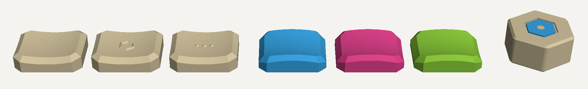
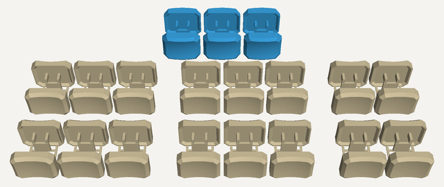
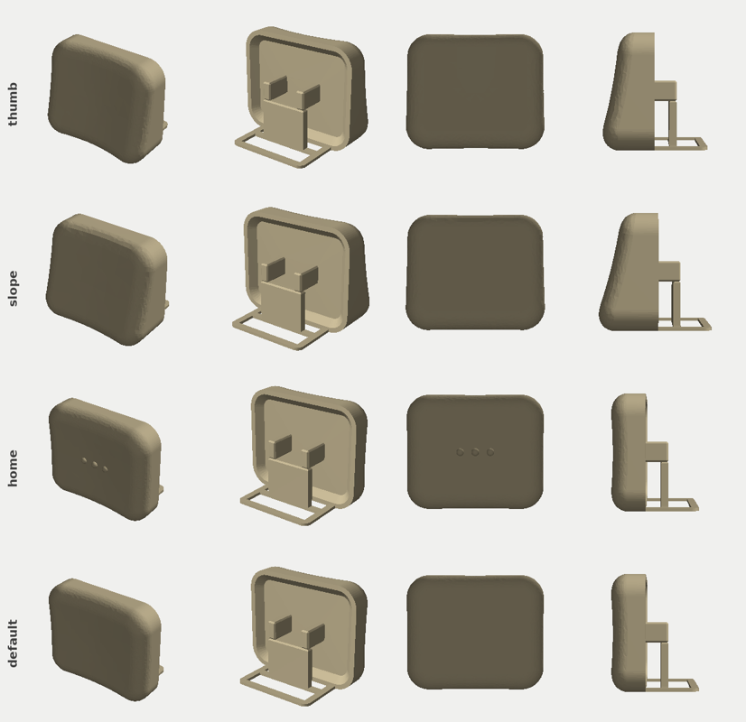

# Keycaps

Choc v1 keycaps for the minY grid of 19 × 16 mm, and a knob for the encoder. Both are modelled in FluidCAD and fully parametric: [keycap.part.js](../case/fluidcad/keycap.part.js) and [encoder-knob.part.js](../case/fluidcad/encoder-knob.part.js). The caps are rebuilt from the sculpted caps that were printed first. Those are kept below as the original, with the geometry measured from them.



## Parametric keycaps

All caps print standing on their front edge. An integrated support carries the stem legs, so the slicer needs no supports. Everything that was measured on the original caps is kept: footprint 18.3 × 15.3 mm, the solid body with a 1 mm pocket underneath, the Choc v1 stem and the support with its frame. What changed is the top surface:

- **Finger (dish):** flat, without the tilt of the old slope caps, and with the shallow dish of the old default cap (0.55 mm across, 0.35 mm along, measured 6 mm from the centre). The parameter **Tilt along the column (°)** brings a tilt back if needed (the old slope caps had about 14°).
- **Thumb (saddle):** concave along the column, so the thumb lies in a shallow trough that runs along the thumb row (0.8 mm, **Saddle trough**). Convex across, so the edges roll away under the thumb instead of digging into it (0.5 mm, **Saddle roll-off**). The thumb caps are 0.5 mm higher at the centre, so the rolled-off edges stay thick enough.
- **Homing mark:** none, three dots as on the old home cap, or a raised hexagon outline in the style of the eyes on the middle cover.

Both surfaces are built the same way. An arc across the key is revolved about an axis parallel to X that lies above the cap, and the revolved body is cut from the blank. The arc decides the shape across the key (concave for the dish, convex for the saddle), and the height of the axis decides the shape along it.

**Print-friendly edges (45°)**, on by default: apart from the stem legs, no face of the standing cap overhangs by more than 45°. Round edges start tangent to the bed at the front edge and overhang almost horizontally there. So the four corners of the footprint and the whole top edge get 45° chamfers instead (**Corner chamfer** 2.2 mm, **Top edge chamfer** 1.5 mm). The homing marks get 45° flanks: the dots become small cones, and the hexagon becomes a ridge with sloped sides. Checked on the exported meshes, the only faces that point down more steeply are the undersides of the stem legs, which the integrated support carries.

The chamfers stay sharp. Their edges are 135° and printing softens them a little. Rounding them failed in OpenCascade: both a fillet over the chamfer edges and a chamfer along rounded footprint corners left degenerate faces, which meshed into tens of thousands of slivers with open edges, or left the top surface not fully cut. With the option off, the cap gets the round edges of the original caps (corner radius 3 mm, top edge 2 mm).

Colours: the case is beige, so all finger caps are beige. The index finger home caps carry the mark in the same colour. The three thumb caps per half take the eye colours blue, pink and green. Each cap is one colour, since a cap printed on edge would need a filament change in almost every layer for a coloured detail on its top.

| Profile | Per half | Total | Colour |
| --- | --- | --- | --- |
| Finger | 15 | 30 | beige |
| Home (index finger) | 1 | 2 | beige |
| Thumb | 3 | 6 | blue, pink, green |

## Encoder knob

A hexagonal knob like the eyes on the middle cover. Its top carries the same eye: a 0.6 mm colour inlay with an open centre and a recessed outline (blue by default; **Eye as colour inlay** off leaves only the outline). The knob prints upside down on its top, so the eye sits in the first three layers.

- 19 mm across the corners, 8.4 mm high, 1 mm above the middle cover.
- D bore for the measured shaft: Ø 6 mm, 4.5 mm from the flat to the opposite side, tip 7.44 mm above the cover, flat 7 mm long. Clearance 0.15 mm per side, a 0.5 mm lead-in at the entrance and 0.4 mm of room above the tip.
- Three crush ribs on the round side of the bore reach 0.1 mm into the shaft and press it against the flat, so the knob holds without a set screw. If it sits too tight or too loose, change **Crush rib interference (mm)** or **Bore clearance (mm)**.

## Print files

```sh
node case/fluidcad/tools/keycap-files.mjs          # home caps with the hexagon
node case/fluidcad/tools/keycap-files.mjs dots     # home caps with three dots
```

For printing by object (OrcaSlicer: print sequence "by object", which gives cleaner caps than printing all at once), the caps come in tight groups. Each group stands in two rows back to back, with 1.5 mm between neighbours, and the cross bars of the support frames overlap, so a group is one stable object. A full set is seven groups:

| Group | Caps | Count | Contents |
| --- | --- | --- | --- |
| Home row | 4 | 2 | three finger caps and the index finger home cap |
| Finger | 6 | 4 | finger caps for the keys around the home rows |
| Thumbs | 6 | 1 | the thumb caps |



All seven in beige make a complete set. An accent colour is a matter of printing one group in another filament, for example the thumbs or the home rows, even on a printer with a single colour. For caps in many colours, print the single caps.

The script writes into `case/fluidcad/print/keycaps/`:

| File | Contents |
| --- | --- |
| `keycaps-set.3mf` | The seven groups as separate objects on one plate (256 × 256 mm): open it, set the print sequence to "by object", and assign filaments per object |
| `keycap-group-home-row.stl`, `keycap-group-finger.stl`, `keycap-group-thumbs.stl` | One group each |
| `keycap-finger`, `keycap-home-<mark>`, `keycap-thumb` | Single caps, as STEP and STL |
| `encoder-knob.stl`, `encoder-knob-eye.stl` | Knob and eye inlay, lined up. Load both as one object with two parts. |

The settings of the original caps should work for the new ones too: 0.12 mm layers, 4 walls, supports only where painted.

## Original sculpted caps

Sculpted Choc v1 caps in four profiles, all built to print standing on one edge, with an integrated support under the stem.



| File | Contents |
| --- | --- |
| [choc-sculpted.step](choc-sculpted.step) | The four profiles as separate solids (`choc_caps_print_ready`, every part named `cap_default_rounded`), lying side by side in print orientation |
| [choc-thumb.stl](choc-thumb.stl) | Not only the thumb cap: the same four profiles as a print cluster, one cap of each, turned outward, with their support frames meeting in the middle |

The print projects [keyboard_p1s.3mf](../case/keyboard_p1s.3mf) (Bambu P1S) and [keyboard_artisan.3mf](../case/keyboard_artisan.3mf) (Snapmaker Artisan) contain the same four meshes on several plates, singly, in grids and as clusters of four.

### Profiles

| Profile | Use | Volume | PLA | Top surface |
| --- | --- | --- | --- | --- |
| default | home row | 913 mm³ | 1.1 g | dished, level |
| home | home row, index finger | 914 mm³ | 1.1 g | like default, plus three homing dots |
| slope | top and bottom row | 1453 mm³ | 1.8 g | dished, tilted by about 14° |
| thumb | thumb keys | 1225 mm³ | 1.5 g | dished more deeply, tilted by about 11° |

The names come from the parts in `keyboard_artisan.3mf`. In `keyboard_p1s.3mf` the cluster of four is called `home_thumb_normal_edge`.

A full set for the 38 keys, assuming top and bottom row get the slope profile and the outer home-row key gets the default profile:

| Profile | Per half | Total |
| --- | --- | --- |
| slope | 10 | 20 |
| default | 5 | 10 |
| home | 1 | 2 |
| thumb | 3 | 6 |

Together that is about 47 cm³, or 59 g of PLA. The old 36-key set in `keyboard_p1s.3mf` (plates 7–9) has 20 slope, 9 default, 1 home and 6 thumb caps. The half set in `keyboard_artisan.3mf` has 11 slope caps instead of 10.

### Geometry

Key coordinates: X across the key (along the row), Y along the column, Z up. Z = 0 is the floor of the pocket on the underside of the cap. In print orientation, X stays, Z points sideways (to −Y in the files), and the key's Y becomes the print height: the cap stands on one of its Y edges, on the thick edge for slope and thumb.

#### Body

- Footprint 18.3 × 15.3 mm (X × Y), corner radius 3.0 mm. That leaves a gap of 0.7 mm to the neighbours in both directions.
- Side walls are vertical. The top edge is rounded with a radius of about 2 mm all around.
- The cap is solid. The underside has a pocket 1.0 mm deep, so the rim reaches down to Z = −1.0.
  - The pocket walls are chamfered at 45° (about 1 mm wide), so they print without support when the cap stands on its edge.
  - The rim is about 1.7 mm wide at the Y edges and about 0.6 mm wide plus the chamfer at the X edges.

#### Top surface

Heights above the pocket floor. "Edge" means 6 mm from the centre across X; outside that the surface rounds over into the side wall.

| Profile | Centre | 2 mm from the thick edge | 2 mm from the thin edge | Dish depth across X | Tilt along Y |
| --- | --- | --- | --- | --- | --- |
| default, home | 2.50 | 2.81 | 2.80 | 0.54 | none |
| slope | 4.51 | 6.17 | 3.41 | 0.53 | 14.1° |
| thumb | 3.50 | 4.85 | 2.76 | 0.79 | 10.8° |

- The dish is curved in both directions: across X about R 30 mm, along Y about R 45–50 mm (measured on default, depth 0.31 mm over ±5.65 mm).
- For slope and thumb the dish lies on a tilted plane. The thick edge stands on the print bed.
- Homing dots (home only): three domes on the centre line across X, at X = −2, 0 and +2 mm, Ø 1.2 mm at the base and 0.5 mm high.

#### Stem (Choc v1)

- Two legs, 1.3 mm wide in X and 2.7 mm long in Y, centred at X = ±2.9 mm (5.8 mm apart) and in the middle of the cap in Y.
- They are 4.0 mm long from the pocket floor.
- Vertical edges are chamfered by 0.2 mm, and the tips by 0.15 mm.

#### Integrated support

The cap prints standing on edge, so the underside of the stem legs overhangs by 4 mm. The integrated support carries it:

- **Wall:** 1.0 mm thick and 7.1 mm wide (covering both legs). It stands at 3–4 mm from the pocket floor and rises from the bed to the underside of the legs (6.3 mm print height). Its top edges are chamfered by 0.2 mm, so it touches the legs on a strip only 0.6 mm wide and breaks off cleanly.
- **Frame on the bed:** 0.4 mm high (two layers). It has two rails 1.0 mm wide at X = ±5.2…6.2 mm, running from the cap rim to 8 mm from the pocket floor. A cross bar joins them at the end, and a foot 12.4 mm wide sits under the wall. The frame ties the cap and the wall together so neither tips over.
- **Material:** about 55 mm³ per cap, around 4–6 % of the cap. That is far less than slicer supports for a cap printed upside down.

The legs therefore bridge only from the pocket floor to the wall, about 3.2 mm.

### Print settings used so far

Both projects use 0.12 mm layers (first layer 0.2 mm), 4 walls, 35 % infill, no brim and supports only where painted ("normal (manual)"), so the integrated support is the only one.

| Project | Filament |
| --- | --- |
| P1S | Translucent PETG in brown `#C9A381` and blue `#61B0FF`, matte black PLA for the test plates |
| Artisan | Matte black PLA |
